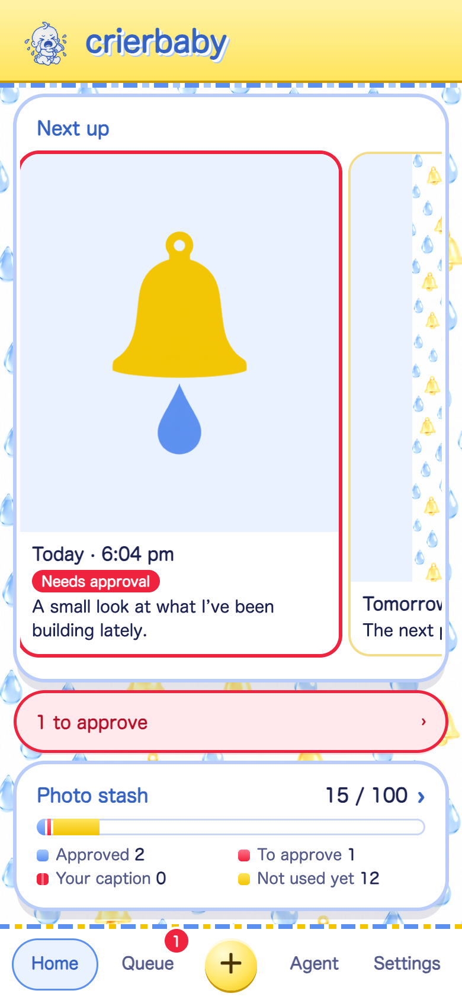
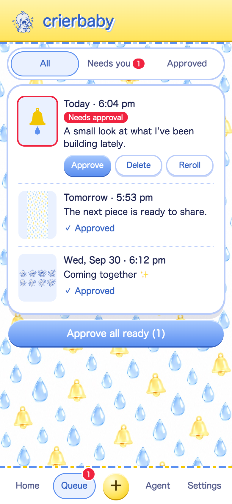
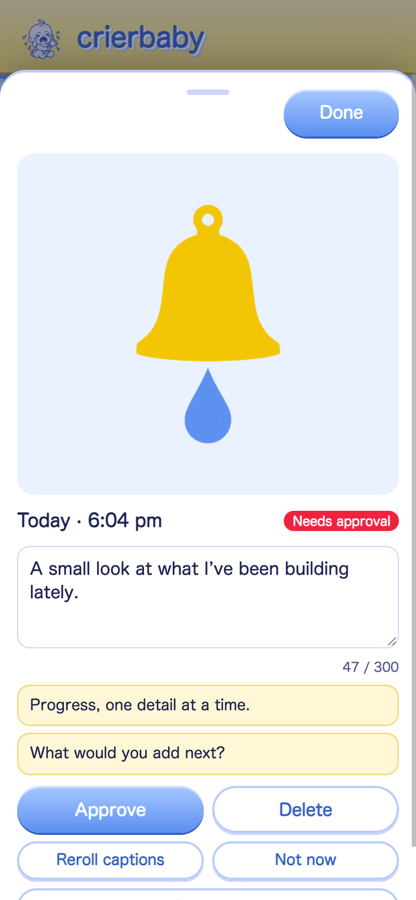
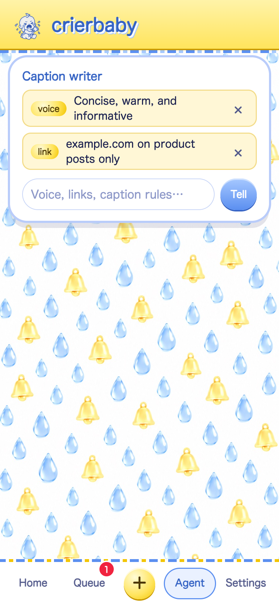
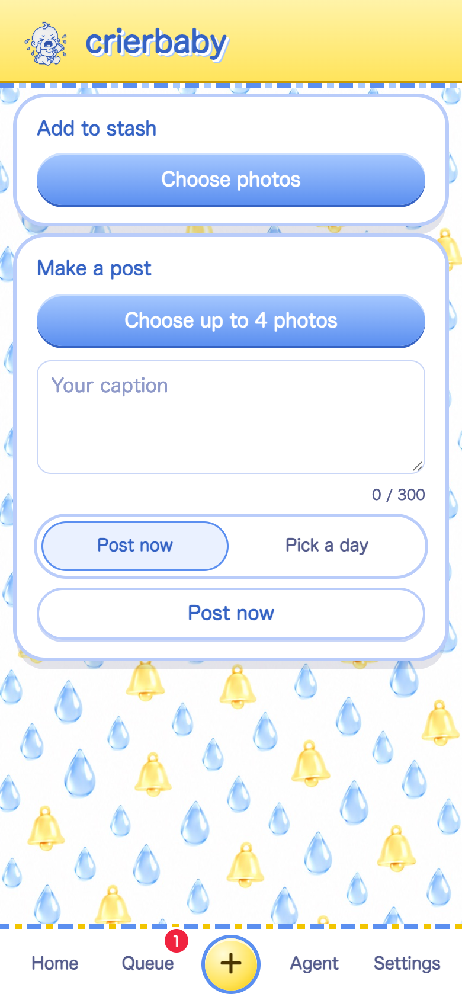

# crierbaby

A self-hosted, approval-first Bluesky photo scheduler with AI-assisted captions. Add a photo stash, review generated caption options, and let a Cloudflare Worker publish approved posts on schedule.

crierbaby is designed for one Bluesky account per deployment. It does not ship with an account, persona, audience, website, or content niche baked in.

<p>
  
  
  
  
  
</p>

## What it does

- Stores queued photo bytes in Cloudflare KV and schedule metadata in D1.
- Generates captions, alt text, and visual descriptions with an OpenAI-compatible vision API.
- Keeps similar-looking photos apart and checks new captions for repetition.
- Requires explicit approval before scheduled posts can publish.
- Supports manual posts, link rules, and ongoing voice instructions.
- Starts with auto-posting paused.

## Requirements

- Node.js 22 or newer
- A Cloudflare account with Workers, D1, and KV
- A Bluesky account and app password
- An OpenAI-compatible vision API key

## Set up your own deployment

1. Install the project dependencies:

   ```sh
   npm install
   ```

2. Create a D1 database and KV namespace:

   ```sh
   npx wrangler d1 create crierbaby
   npx wrangler kv namespace create KV
   ```

3. Copy the returned IDs into `wrangler.toml`. The checked-in values are deliberately non-deployable placeholders so a clone cannot point at someone else’s data.

4. Initialize the database:

   ```sh
   npx wrangler d1 execute crierbaby --remote --file=schema.sql
   ```

5. Add deployment secrets:

   ```sh
   npx wrangler secret put POSTER_PIN
   npx wrangler secret put BLUESKY_HANDLE
   npx wrangler secret put BLUESKY_APP_PASSWORD
   npx wrangler secret put AI_API_KEY
   ```

   The default AI endpoint and model are NVIDIA's OpenAI-compatible API and `google/gemma-4-31b-it`. To use another compatible vision provider, set the optional `AI_BASE_URL` and `AI_MODEL` Worker variables.

6. Deploy:

   ```sh
   npm run deploy
   ```

Auto-posting remains paused until it is enabled from Settings.

## Local development

Initialize a local D1 database, provide local development secrets through Wrangler’s ignored local-secret mechanism, and run:

```sh
npm test
npm run dev
```

Never commit a Bluesky app password, API key, PIN, real Cloudflare resource ID, or private photo.

## Using the app

- **Home** shows the upcoming queue and anything needing attention.
- **Queue** lets you approve, edit, reroll, postpone, delete, or immediately publish a post.
- **Add** accepts photos for the stash or a one-off post.
- **Agent** accepts plain-language instructions such as `Use a concise, informative tone` or `Include example.com on product posts`.
- **Settings** controls auto-posting.

The default caption prompt is intentionally neutral. Use Agent notes to define the account’s actual voice and constraints.

## Portfolio demo

Open the deployed app with `?demo=1` to preview the full interface with sample data. Demo mode is read-only: it does not require credentials and cannot publish anything.

The normal lock screen includes a configuration checklist. Secrets are intentionally entered with `wrangler secret put`, not in the browser, so they remain encrypted in Cloudflare rather than being saved in client-side storage.

## Architecture

The static app lives in `app/`. The Worker API and scheduler live in `worker/`. D1 stores queue state; KV stores image bytes, sessions, and the PIN rate-limit counter. A cron trigger checks for due approved posts every 15 minutes.

## License

The code is available under the [MIT License](LICENSE). The included mascot, background, and app icons are original project artwork distributed with the repository under the same license.
